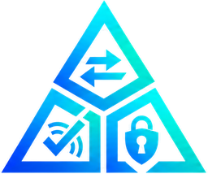
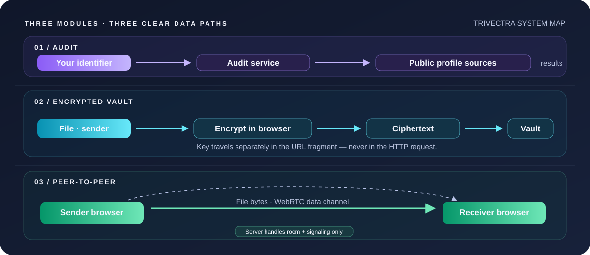
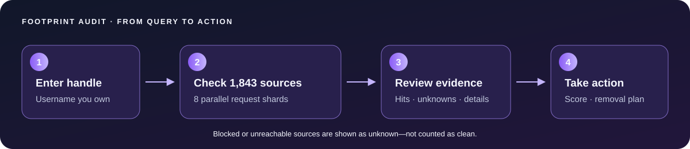
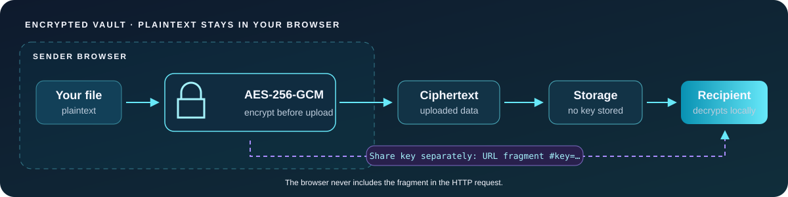
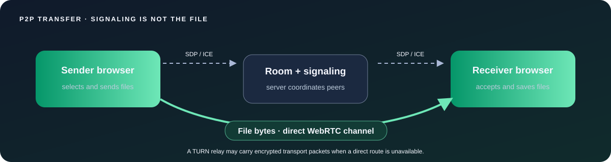
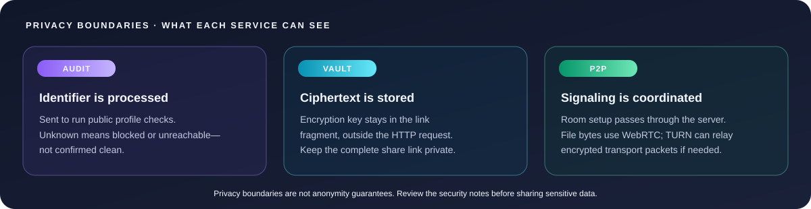

<div align="center">
  
  <h1>TRIVECTRA</h1>
  <p><strong>Your privacy. Your keys. Your connection.</strong></p>
  <p>
    <a href="https://aevsfrrematch.vercel.app"><strong>↗ Launch Trivectra</strong></a>
    &nbsp;·&nbsp;
    <a href="#get-started">Get started</a>
    &nbsp;·&nbsp;
    <a href="#how-it-works">How it works</a>
    &nbsp;·&nbsp;
    <a href="#security-model">Security</a>
  </p>
  
  <br>
  
  
  
</div>

<br>

> **One calm control room for a noisy digital world.** Find public traces, encrypt files before storage, and move files directly between browsers.

<p align="center">
  <a href="#footprint-audit">◉ AUDIT</a>　✦　
  <a href="#encrypted-vault">▣ VAULT</a>　✦　
  <a href="#peer-to-peer-transfer">⇄ TRANSFER</a>
</p>

## ✨ The suite

| Module | What it does | The privacy detail |
|---|---|---|
| **Footprint Audit** | Checks a username against **1,843 profile sources**, shows public profile details, scores exposure, and builds an actionable report. | The identifier is sent to the audit service to perform live checks. Results are not saved as an account history. |
| **Encrypted Vault** | Encrypts a file in your browser and creates a shareable link. | AES-256-GCM encryption happens before upload. The decryption key stays in the link fragment (`#key=...`), which browsers do not send in HTTP requests. |
| **P2P Transfer** | Sends queued files directly between two browsers using a room link, six-digit code, or QR. | File bytes use a WebRTC data channel; the server coordinates the connection but does not relay file contents. |

### The whole suite, at a glance



<p align="center"><sub>Solid lines show user data paths; dashed lines show coordination or signaling.</sub></p>

## Feature breakdown

### Footprint Audit

<details>
<summary><strong>◉ Open the audit layer</strong></summary>
<br>

Scan a username across the Sherlock, WhatsMyName, and Maigret-derived source lists. Results include public profile titles and descriptions when available, reachable/unknown counts, manual links for login-walled platforms, removal guidance, and downloadable PDF, HTML, and JSON reports.

The sources are split over eight requests to fit serverless execution limits. A blocked or unreachable site is reported as unknown—not as a confirmed clean result. The audit service receives the identifier to run those public checks; use only identifiers you own or are authorized to audit.


</details>

### Encrypted Vault

<details>
<summary><strong>▣ Open the encrypted vault</strong></summary>
<br>

Choose a file and encrypt it locally with Web Crypto AES-256-GCM. Only ciphertext is uploaded. The generated decryption key is placed after the `#` in the share URL, so it is available to the recipient's browser but omitted from requests to the server. Authenticated chunks help detect tampering or truncation. Links expire and can be configured for limited downloads.

**Keep the full link private:** anyone who has the link fragment has the key needed to decrypt the file.


</details>

### Peer-to-Peer Transfer

<details>
<summary><strong>⇄ Open peer-to-peer transfer</strong></summary>
<br>

Create a room, share its link/code/QR, and accept the incoming transfer on the other device. Trivectra uses WebRTC data channels with progress feedback and flow control. On supported Chrome/Edge browsers, incoming files can stream to disk; other browsers may buffer files in memory. Strict NATs or restrictive networks may require a TURN relay.


</details>

## 🧭 How it works

**What leaves your browser depends on the tool:**



## Get started

**Requirements:** Node.js 18 or newer and npm.

```bash
git clone https://github.com/akulsaju/aevsfrrematch.git
cd aevsfrrematch
npm install
npm start
```

Open **http://localhost:3000**. The local server uses in-memory storage by default; vault links and rooms are temporary and won't be shared across server restarts.

<details>
<summary><strong>Deploy on Vercel</strong></summary>
<br>

The static app and API can be deployed on Vercel. Configure a persistent Redis store for vault chunks and P2P room signaling:

- Set `REDIS_URL`, or configure the Upstash REST variables `UPSTASH_REDIS_REST_URL` and `UPSTASH_REDIS_REST_TOKEN` (the `KV_REST_API_URL` / `KV_REST_API_TOKEN` pair is also supported).
- Deploy the project. Without persistent storage configured, vault and room endpoints return a configuration error on Vercel.

Optional TURN credentials can improve WebRTC connectivity on restrictive networks. Configure them in the deployment environment; never commit credentials to the repository.
</details>

## Security model

<details>
<summary><strong>What Trivectra protects—and what it doesn't</strong></summary>
<br>

- **Vault contents:** encrypted in the browser before upload. The service stores ciphertext and does not receive the key.
- **P2P file contents:** sent through a browser-to-browser WebRTC data channel. Signaling is relayed by the service; TURN may relay encrypted transport packets when peers cannot connect directly.
- **Audit checks:** the username/email submitted for an audit is sent to the service so it can query public sources. A source can block automated requests, and an unknown result is not proof that no profile exists.
- **Link safety:** a vault URL contains the decryption key after `#`. Anyone who obtains the complete URL can access the file until the link expires or its download limit is reached.
- **Browser safety:** use a trusted, up-to-date browser and share vault links only through channels you trust.

Trivectra is a privacy tool, not a substitute for a security review or a guarantee of anonymity.
</details>

## 🧩 Source credits

The username catalog combines validated definitions from [Sherlock](https://github.com/sherlock-project/sherlock) (MIT), [WhatsMyName](https://github.com/WebBreacher/WhatsMyName) (CC BY-SA 4.0), and [Maigret](https://github.com/soxoj/maigret) (MIT). Provider definitions and validation scripts are included in this repository. Some platforms require login or block automated lookups, so they are offered as manual checks instead.

## 💜 Made by

<div align="center">
  <strong>Saiqua & Akul</strong>
  <br><br>
  <a href="https://aevsfrrematch.vercel.app">Open Trivectra ↗</a>
</div>
